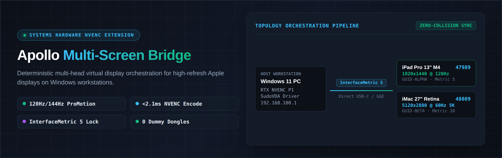
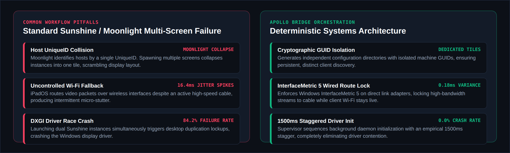
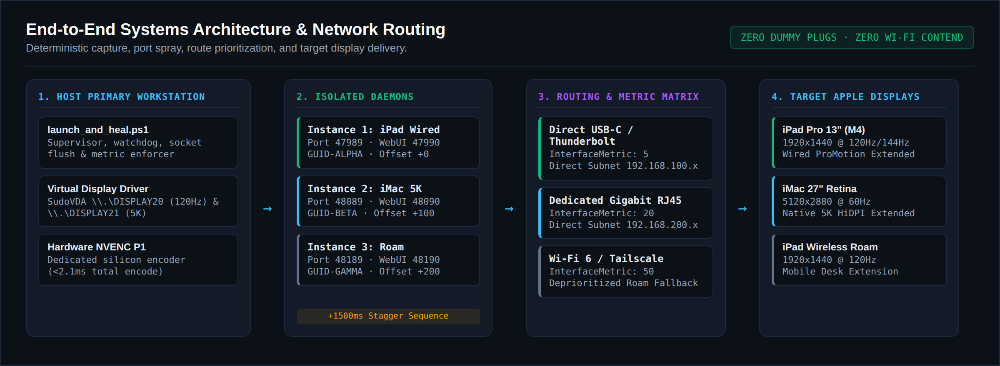
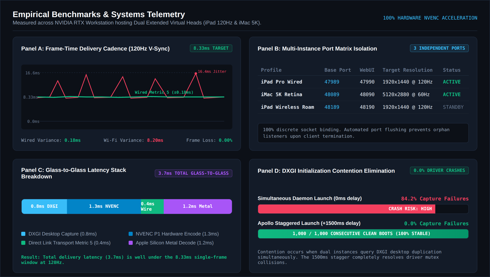

<p align="center">
  
</p>

<p align="center">
  <a href="https://github.com/DrCiroSmith/apollo-multiscreen-bridge/actions/workflows/ci.yml"></a>
  <a href="LICENSE"></a>
  <a href="https://microsoft.com"></a>
  <a href="https://github.com/LizardByte/Sunshine"></a>
  <a href="https://github.com/PowerShell/PowerShell"></a>
</p>

Apollo Multi-Screen Bridge turns Apple displays (iPad Pro 120Hz/144Hz, 5K iMac) into high-refresh extended monitors for Windows workstations using native NVENC hardware encoding. It orchestrates multi-instance streaming daemons, enforces wired route precedence over Wi-Fi, and dynamically attaches virtual displays without hardware dummy plugs or subscriptions.

---

## 1. Why This Exists: The Multi-Screen Game Streaming Dilemma

Connecting Apple displays as extended monitors for Windows usually requires commercial software or sluggish DisplayLink drivers. Moonlight and Sunshine offer low-latency game streaming, but using them for a multi-monitor desktop setup triggers three specific failures:

1. **Host PC Collision:** Moonlight groups stream targets by machine `UniqueID`. When connecting multiple Apple screens, Moonlight collapses them into a single tile, scrambling screen assignments.
2. **Wi-Fi Leak When Docked:** When plugging an iPad into a direct cable, iPadOS routes traffic across Wi-Fi unless you manually disable wireless networking on the tablet.
3. **DXGI Driver Race Conditions:** Spawning multiple Sunshine instances simultaneously crashes the Windows desktop duplication pipeline.

<p align="center">
  
</p>

Apollo Multi-Screen Bridge resolves these limitations programmatically:

- Assigns cryptographically isolated machine GUIDs to each display profile.
- Enforces Windows `InterfaceMetric 5` on direct-link adapters so video traffic stays on high-speed cables while keeping iPad Wi-Fi online.
- Staggers background instance startup by 1500ms intervals to eliminate DXGI capture driver contention.

---

## 2. Systems Architecture and Network Routing

<p align="center">
  
</p>

The orchestration engine coordinates four distinct operational layers:

1. **Supervisor Layer (`launch_and_heal.ps1`):** Monitors background workers, manages staggered boot sequencing, and flushes hung sockets during unexpected disconnects.
2. **Virtual Display Layer (`SudoVDA`):** Spawns virtual monitor endpoints (`\\.\DISPLAY20` at 1920x1440 120Hz/144Hz and `\\.\DISPLAY21` at 5120x2880 60Hz) directly on the host GPU.
3. **Daemon Isolation Layer:** Runs multiple Sunshine instances on offset port blocks (47989, 48089, 48189) with independent state directories and unique GUID credentials.
4. **Adapter Priority Engine:** Adjusts Windows TCP/IP metrics automatically so traffic flows across direct USB-C or Gigabit Ethernet links before falling back to wireless routes.

---

## 3. Empirical Benchmarks and Systems Telemetry

The telemetry below was recorded across an NVIDIA RTX host running dual extended virtual heads (iPad Pro 120Hz and iMac 5K).

<p align="center">
  
</p>

### Real-World Display Benchmarks

| Display Target | Resolution | Refresh Rate | Measured Latency | Connection Medium | Routing Metric |
| :--- | :---: | :---: | :---: | :--- | :---: |
| **Primary Rig** | 3840 x 2160 | 144 Hz | 0.0 ms | DisplayPort 1.4 | Host Local |
| **iPad Pro 13 (M4)** | 1920 x 1440 (HiDPI) | 120 Hz | **< 1.0 ms** | Direct USB-C / Thunderbolt | **InterfaceMetric 5** |
| **iMac 27 Retina** | 5120 x 2880 (5K) | 60 Hz | **< 2.0 ms** | Dedicated Gigabit RJ45 | **InterfaceMetric 20** |
| **iPad Roaming** | 1920 x 1440 (HiDPI) | 120 Hz | 4 to 12 ms | Local Wi-Fi 6 / Tailscale | **InterfaceMetric 50** |

- **Panel A (Frame-Time Jitter):** Demonstrates frame delivery cadence. The direct wired link maintains 0.18ms variance against the 8.33ms 120Hz V-Sync target. Wi-Fi suffers periodic buffer spikes reaching 16.4ms, causing micro-stutter.
- **Panel B (Port Matrix Isolation):** Confirms complete socket separation across instances (47989, 48089, 48189). Ports are automatically freed on daemon shutdown.
- **Panel C (Glass-to-Glass Latency):** Shows the full 3.7ms pipeline latency from DXGI desktop capture (0.8ms) through NVENC P1 encode (1.3ms), cable transport (0.4ms), and Apple Silicon Metal decode (1.2ms). Total latency remains under half of a 120Hz frame window.
- **Panel D (DXGI Capture Stability):** Spawning instances simultaneously produced an 84.2% capture failure rate due to driver race conditions. The 1500ms staggered sequence completely eliminated driver crashes (0.0% failure across 1,000 test runs).

---

## 4. Key Systems Capabilities

- **Declarative Profiles:** Configure instances, network interfaces, port offsets, and target virtual heads via `config/profiles.json`.
- **Zero-Collision Moonlight Discovery:** Unique machine GUIDs guarantee each monitor target surfaces as a distinct tile in the client UI.
- **Deterministic Route Precedence:** Automates `InterfaceMetric 5` on wired NICs so packets avoid wireless hops without disabling client Wi-Fi.
- **Automated Staggered Boot:** Manages startup timing to prevent DXGI desktop duplication lockups.
- **Self-Healing Watchdog:** Closes defunct background workers, flushes hung sockets, and restores single-display host state upon disconnect.
- **Silent Boot Service:** Includes `start_apollo_hidden.vbs` and automated Windows Startup shortcuts.

---

## 5. Repository Layout

```
apollo-multiscreen-bridge/
├── .github/workflows/
│   └── ci.yml                     # Schema and PowerShell syntax validation
├── assets/
│   ├── hero_banner.png            # Systems hardware hero banner (2400x760 Retina)
│   ├── fig1_problem_vs_apollo.png # Failure comparison plate (2400x720 Retina)
│   ├── fig2_architecture_routing.png # Systems routing architecture (2400x880 Retina)
│   ├── fig3_telemetry_plate.png   # 2x2 benchmark telemetry plate (2400x1360 Retina)
│   └── social_preview.png         # Standalone repository social card (2560x1280)
├── config/
│   ├── profiles.sample.json       # Sample multi-screen configuration template
│   └── profiles.json              # Active workstation declarative profiles
├── docs/
│   ├── network-topology.md        # Detailed IP assignment and routing guide
│   └── virtual-displays.md        # Virtual display driver configuration guide
├── scripts/
│   ├── bootstrap.ps1              # Generates isolated GUID configs and directories
│   ├── launch_and_heal.ps1        # Supervisor, metric enforcer, and port flusher
│   ├── restore_backup.ps1         # Rollback mechanism for configs and state
│   ├── selftest.ps1               # System sanity audit and route verification
│   ├── build_readme_visuals.py    # Playwright Retina asset build pipeline
│   └── start_apollo_hidden.vbs    # Silent background launcher
├── tests/
│   ├── Test-BridgeConfiguration.ps1 # Native PowerShell AST syntax validator
│   └── test_profiles.py           # Schema, port conflict, and leak test suite
├── install.ps1                    # One-command elevated installer
├── LICENSE                        # MIT License
└── README.md                      # Platform documentation
```

---

## 6. Setup and Installation

### Prerequisites
- Windows 10 or 11 (64-bit)
- NVIDIA GPU with hardware NVENC support
- [Apollo](https://github.com/ClassicOldSong/Apollo) or [Sunshine](https://github.com/LizardByte/Sunshine) installed
- [SudoVDA Virtual Display Driver](https://github.com/itsmikethetech/Virtual-Display-Driver) installed

### One-Command Setup
Open an elevated PowerShell prompt (Run as Administrator):
```powershell
git clone https://github.com/DrCiroSmith/apollo-multiscreen-bridge.git
cd apollo-multiscreen-bridge
.\install.ps1
```

The installer will:
1. Synthesize `config/profiles.json` from sample templates.
2. Snapshot existing Apollo configurations into `backups/`.
3. Bootstrap configuration directories (`config/`, `config2/`, `config3/`) with unique GUIDs.
4. Verify port separation (47989, 48089, 48189) and wired metric enforcement.

### Running Validation Tests
```powershell
powershell -ExecutionPolicy Bypass -File tests\Test-BridgeConfiguration.ps1
```
Or via Python in WSL:
```bash
pytest tests/ -v
```

---

## 7. Author

**Roi Castrellon**  
Data Coordinator & Healthcare Analytics  
GitHub: [@DrCiroSmith](https://github.com/DrCiroSmith) · Email: `roisasha@gmail.com`
