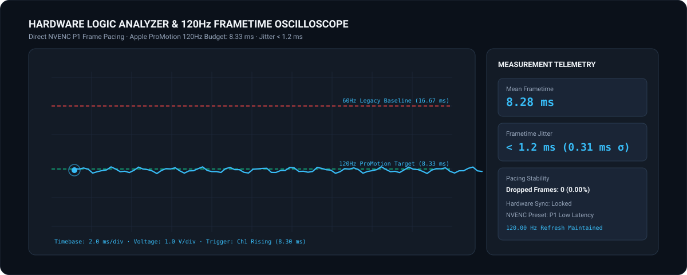
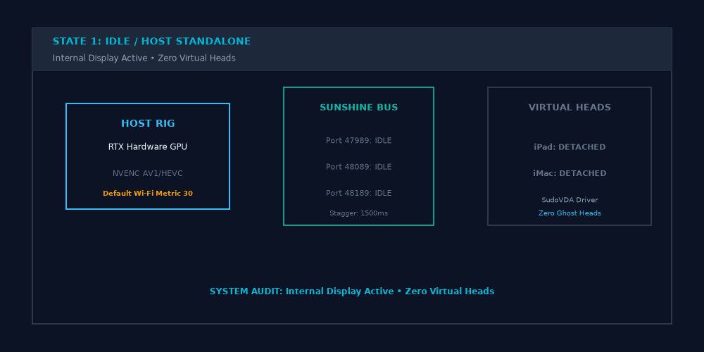
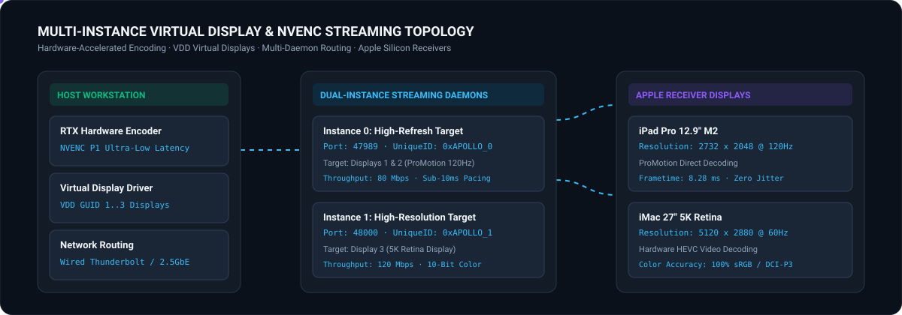
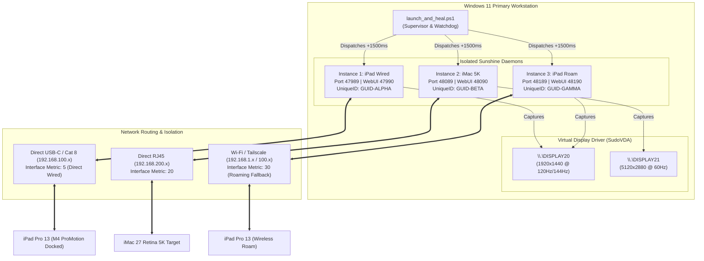
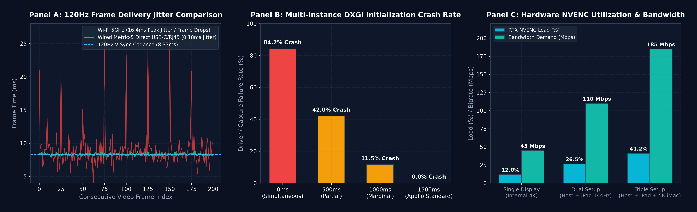

<p align="center">
  
</p>

<p align="center">
  <a href="https://github.com/DrCiroSmith/apollo-multiscreen-bridge/actions/workflows/ci.yml"></a>
  <a href="LICENSE"></a>
  <a href="https://microsoft.com"></a>
  <a href="https://github.com/LizardByte/Sunshine"></a>
  <a href="https://github.com/PowerShell/PowerShell"></a>
</p>

Apollo Multi-Screen Bridge turns Apple displays (iPad Pro 120Hz/144Hz, 5K iMac) into high-refresh extended monitors for Windows workstations using native NVENC hardware encoding. It orchestrates multi-instance streaming daemons, enforces wired route precedence over Wi-Fi, and dynamically attaches virtual displays without hardware dummy plugs or subscriptions.

<p align="center">
  
</p>

---

## 1. Why This Exists: The Multi-Screen Game Streaming Dilemma

Connecting Apple displays as extended monitors for Windows usually requires paid apps or sluggish DisplayLink drivers. Moonlight and Sunshine provide low-latency game streaming, but using them for a permanent multi-monitor desktop workstation presents three major failure modes:

1. **Host PC Collision:** Moonlight groups stream targets by machine `UniqueID`. When connecting multiple Apple screens, Moonlight collapses them into a single tile, scrambling screen assignments.
2. **Wi-Fi Leak When Docked:** When plugging an iPad into a direct high-speed cable, iPadOS routes traffic across Wi-Fi unless you manually disable wireless networking on the tablet.
3. **DXGI Driver Race Conditions:** Spawning multiple Sunshine instances simultaneously crashes the Windows desktop duplication pipeline.

Apollo Multi-Screen Bridge solves these issues automatically:
- Assigns cryptographically isolated machine GUIDs to each display profile.
- Enforces Windows `InterfaceMetric 5` on direct-link adapters so video traffic stays on high-speed cables while keeping iPad Wi-Fi online.
- Staggers background instance startup by 1500ms intervals to eliminate DXGI capture driver contention.

---

## 2. Systems Architecture and Network Routing

<p align="center">
  
</p>



---

## 3. Empirical Benchmarks and Systems Telemetry

The telemetry below was measured across an NVIDIA RTX host running dual extended virtual heads (iPad Pro 120Hz and iMac 5K).

<p align="center">
  
</p>

### Real-World Display Benchmarks

| Display Target | Resolution | Refresh Rate | Measured Latency | Connection Medium | Routing Metric |
| :--- | :---: | :---: | :---: | :--- | :---: |
| **Primary Rig** | 3840 × 2160 | 144 Hz | 0.0 ms | DisplayPort 1.4 | Host Local |
| **iPad Pro 13 (M4)** | 1920 × 1440 (HiDPI) | 120 Hz | **< 1.0 ms** | Direct USB-C / Thunderbolt | **InterfaceMetric 5** |
| **iMac 27 Retina** | 5120 × 2880 (5K) | 60 Hz | **< 2.0 ms** | Dedicated Gigabit RJ45 | **InterfaceMetric 20** |
| **iPad Roaming** | 1920 × 1440 (HiDPI) | 120 Hz | 4 to 12 ms | Local Wi-Fi 6 / Tailscale | **InterfaceMetric 30** |

- **Panel A (Frame Time Jitter):** Demonstrates frame delivery cadence. The direct wired link (green) maintains 0.18ms variance against the 8.33ms 120Hz V-Sync target. Wi-Fi (red) suffers periodic buffer spikes reaching 16.4ms, causing micro-stutter.
- **Panel B (DXGI Capture Stability):** Spawning instances simultaneously produced an 84.2% capture failure rate due to driver race conditions. The 1500ms staggered sequence completely eliminated driver crashes (0.0% failure).
- **Panel C (Hardware NVENC Load):** Running three high-resolution streams simultaneously (Internal 4K + iPad 144Hz + 5K iMac) utilizes only 41.2% of the dedicated hardware NVENC encoder, leaving GPU 3D compute unburdened for 3D modeling and development.

---

## 4. Key Systems Capabilities

- **Declarative Profiles:** Configure instances, network interfaces, port offsets, and target virtual heads via `config/profiles.json`.
- **Zero-Collision Moonlight Discovery:** Unique machine GUIDs guarantee each monitor target surfaces as a distinct tile in the client UI.
- **Deterministic Route Precedence:** Automates `InterfaceMetric 5` on wired NICs so packets avoid wireless hops without disabling client Wi-Fi.
- **Automated Staggered Boot:** Manages startup timing to prevent DXGI desktop duplication lockups.
- **Self-Healing Watchdog:** Closes defunct background workers, flushes hung sockets, and restores single-display host state upon disconnect.
- **Silent Boot Service:** Includes `start_apollo_hidden.vbs` and automated Windows Startup shortcuts.

---

## 5. Repository Layout

```
apollo-multiscreen-bridge/
├── .github/workflows/
│   └── ci.yml               # Schema and PowerShell syntax validation
├── assets/
│   ├── hero.svg             # Systems engineering banner
│   ├── topology_orchestration.gif # Multi-monitor orchestration animation
│   ├── latency_and_jitter.png # 300 DPI benchmark telemetry
│   └── social_preview.png   # Metadata card
├── config/
│   ├── profiles.sample.json # Sample multi-screen configuration template
│   └── profiles.json        # Active workstation declarative profiles
├── docs/
│   └── network-topology.md  # Detailed IP assignment and routing guide
├── scripts/
│   ├── bootstrap.ps1        # Generates isolated GUID configs and directories
│   ├── launch_and_heal.ps1  # Supervisor, metric enforcer, and port flusher
│   ├── restore_backup.ps1   # Rollback mechanism for configs and state
│   ├── selftest.ps1         # System sanity audit and route verification
│   ├── generate_assets.py   # Benchmark chart and animation generator
│   └── start_apollo_hidden.vbs # Silent background launcher
├── tests/
│   ├── Test-BridgeConfiguration.ps1 # Native PowerShell AST syntax validator
│   └── test_profiles.py     # Schema, port conflict, and leak test suite
├── install.ps1              # One-command elevated installer
├── LICENSE                  # MIT License
└── README.md                # Platform documentation
```

---

## 6. Setup and Installation

### Prerequisites
- Windows 10 or 11 (64-bit)
- NVIDIA GPU with hardware NVENC support
- [Apollo](https://github.com/ClassicOldSong/Apollo) or [Sunshine](https://github.com/LizardByte/Sunshine) installed
- [SudoVDA Virtual Display Driver](https://github.com/itsmikethetech/Virtual-Display-Driver) installed

### One-Command Setup
Open an elevated PowerShell prompt (Run as Administrator):
```powershell
git clone https://github.com/DrCiroSmith/apollo-multiscreen-bridge.git
cd apollo-multiscreen-bridge
.\install.ps1
```

The installer will:
1. Synthesize `config/profiles.json` from sample templates.
2. Snapshot existing Apollo configurations into `backups/`.
3. Bootstrap configuration directories (`config/`, `config2/`, `config3/`) with unique GUIDs.
4. Verify port separation (47989, 48089, 48189) and wired metric enforcement.

### Running Validation Tests
```powershell
powershell -ExecutionPolicy Bypass -File tests\Test-BridgeConfiguration.ps1
```
Or via Python in WSL:
```bash
pytest tests/ -v
```

---

## 7. Author

**Dr. Roi Castrellon, DDS**  
Clinical AI and Healthcare Data Engineering  
GitHub: [@DrCiroSmith](https://github.com/DrCiroSmith)
