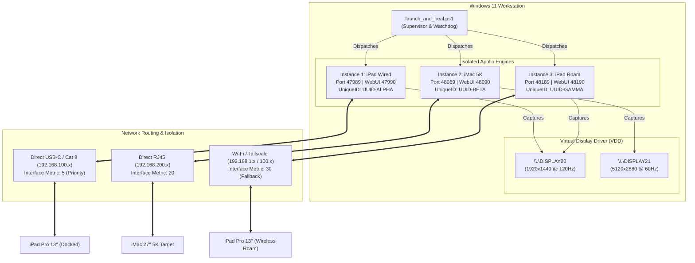

<div align="center">

# Apollo Multi-Screen Bridge 🚀

**Zero-collision multi-instance orchestration, deterministic wired priority, and virtual display routing for Apollo & Sunshine on Windows.**

[](LICENSE)
[](https://microsoft.com)
[](https://github.com/LizardByte/Sunshine)
[](https://github.com/PowerShell/PowerShell)

</div>

---

## 🌟 Overview

Streaming multiple ultra-high-resolution, high-refresh-rate displays simultaneously (such as an **iPad Pro 13" M4 @ 120Hz ProMotion** alongside an **iMac 27" 5K @ 60Hz Retina**) from a single Windows workstation has historically presented critical hurdles:

1. **Host Identity Collisions**: Moonlight clients identify hosts strictly by machine `uniqueid`. Running multiple instances naively causes Moonlight to merge tiles, overwrite IPs, or lose pairing state.
2. **Network Routing Flapping**: Re-docking an iPad over a 1Gbps / 2.5Gbps direct USB-C link often defaults back to congested Wi-Fi routes without turning off Wi-Fi on iPadOS.
3. **DXGI Output Locks**: Launching multiple Sunshine services at the same instant causes race conditions during DXGI virtual display enumeration.
4. **Configuration Fragility**: Apollo's C++ parser (`nlohmann::json`) strictly validates state datatypes, crashing if boolean properties or permissions are formatted improperly.

**Apollo Multi-Screen Bridge** solves this with a declarative, self-healing orchestration toolkit that runs isolated, collision-free instances in a single click.

---

## 🏗️ Architecture & Topology



---

## ✨ Features

- **Declarative JSON Profiles**: Configure instances, ports, displays, resolutions, and interface metrics in `config/profiles.json`.
- **Zero-Collision Moonlight Discovery**: Cryptographically unique machine GUIDs ensure each instance appears as a distinct, dedicated tile in Moonlight.
- **Deterministic Wired Priority**: Automates `InterfaceMetric 5` on direct link adapters so traffic routes through high-speed cables without turning off client Wi-Fi.
- **Firewall Interface Isolation**: Drops wired broadcast traffic across Wi-Fi adapters, preventing confusing duplicates when roaming.
- **Self-Healing Watchdog**: Automatically flushes hung sockets, closes defunct processes, and performs staggered launches to prevent DXGI driver contention.
- **Instant Snapshot & Restore**: One-command rollback for all configurations, app lists, and state files.
- **Silent Boot Launcher**: Includes `start_apollo_hidden.vbs` and automated Windows Startup folder shortcuts for seamless execution on reboot.

---

## ⚡ Quick Start

### 1. Clone & Install
Open an elevated PowerShell prompt (Run as Administrator):

```powershell
git clone https://github.com/DrCiroSmith/apollo-multiscreen-bridge.git
cd apollo-multiscreen-bridge
.\install.ps1
```

The installer will:
1. Synthesize `config/profiles.json` from sample templates.
2. Snapshot any existing Apollo configurations into `backups/`.
3. Bootstrap configuration directories (`config/`, `config2/`, `config3/`) with unique GUIDs.
4. Enforce firewall rules and network interface metrics.
5. Place a **"Start Apollo Instances"** shortcut on your Desktop and in the Windows Startup folder.
6. Launch all instances and run the automated self-test suite.

---

## ⚙️ Declarative Profile Configuration

Edit `config/profiles.json` to suit your monitor setup and network interfaces:

```json
{
  "general": {
    "sunshine_dir": "C:\\Program Files\\Apollo",
    "sunshine_bin": "sunshine.exe",
    "stagger_delay_ms": 1500
  },
  "profiles": [
    {
      "id": "ipad-wired",
      "name": "Apollo-iPad Wired",
      "config_dir": "config",
      "port_base": 47989,
      "webui_port": 47990,
      "display": {
        "output_name": "\\\\.\\DISPLAY20",
        "resolution": "1920x1440",
        "refresh_rate": 120,
        "virtual_display": true
      },
      "network": {
        "interface_alias": "Ethernet 2",
        "priority_metric": 5,
        "enforce_wired_only": true,
        "block_on_interfaces": ["Wi-Fi"]
      }
    },
    {
      "id": "imac-direct",
      "name": "Apollo-iMac",
      "config_dir": "config2",
      "port_base": 48089,
      "webui_port": 48090,
      "display": {
        "output_name": "\\\\.\\DISPLAY21",
        "resolution": "5120x2880",
        "refresh_rate": 60,
        "virtual_display": true
      },
      "network": {
        "interface_alias": "Ethernet",
        "priority_metric": 20
      }
    }
  ]
}
```

---

## 🛠️ Toolkit CLI Reference

| Script | Purpose | Example Usage |
| :--- | :--- | :--- |
| `install.ps1` | 1-Click end-to-end setup and deployment | `.\install.ps1` |
| `scripts\bootstrap.ps1` | Generates isolated configs, GUIDs & firewall rules | `.\scripts\bootstrap.ps1` |
| `scripts\launch_and_heal.ps1` | Flushes sockets, sets metrics & launches instances | `.\scripts\launch_and_heal.ps1` |
| `scripts\selftest.ps1` | Fast sub-second health and collision matrix check | `.\scripts\selftest.ps1` |
| `scripts\restore_backup.ps1` | Snapshot creation and configuration rollback | `.\scripts\restore_backup.ps1 -List` |
| `scripts\start_apollo_hidden.vbs` | Silent launcher without PowerShell window flash | Double-click or run via Windows Shortcut |

---

## 📱 Moonlight Client Pairing Guide

1. **iPad Wired**:
   - In Moonlight on iPad, tap **Add Host Manually**.
   - Enter your direct cable IP (e.g., `192.168.100.1`).
   - Open WebUI at `https://127.0.0.1:47990/pin` on the host to approve the pairing PIN.
2. **iMac Direct**:
   - In Moonlight on iMac, enter the direct IP (e.g., `192.168.200.1`).
   - Open WebUI at `https://127.0.0.1:48090/pin` to approve the PIN.
3. **iPad Roaming**:
   - In Moonlight on iPad, enter your Wi-Fi or Tailscale IP (e.g., `192.168.1.50` or `100.x.y.z`).
   - Open WebUI at `https://127.0.0.1:48190/pin` to approve the PIN.

---

## 📖 In-Depth Guides

- [Network Topology & Routing Architecture](docs/network-topology.md)
- [Virtual Display Management & DXGI Capture](docs/virtual-displays.md)

---

## 📄 License

Distributed under the MIT License. See [LICENSE](LICENSE) for details.
